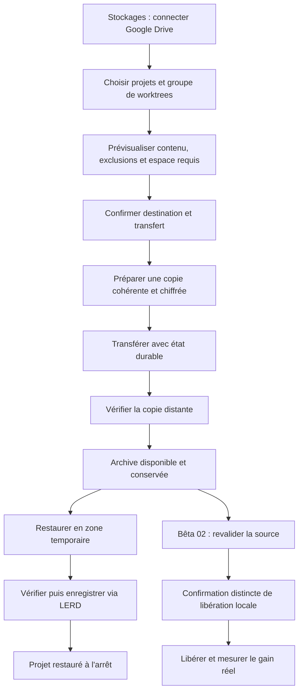

# Archives — feuille de route

État au 31 octobre 2026 : préparation documentaire. Aucune bêta disponible.
Branche de travail : `dev/archives`. Pas de publication automatique.

## Nommage

| Étape affichée | Version prévue | Objectif |
|---|---|---|
| Préparation | manifeste actuel `0.0.0-concept` | Contrats et parcours |
| Préversion 01, 02… | `0.1.0-alpha.1`, `.2`… | Essais locaux sur données jetables |
| Bêta 01 | `0.1.0-beta.1` | Sauvegarder sur Google Drive et restaurer |
| Bêta 02 | `0.1.0-beta.2` | Archivage avec libération locale contrôlée |
| Bêta 03 | `0.1.0-beta.3` | Destinations supplémentaires et robustesse |
| Version stable | `0.1.0` | Critères validés et limites documentées |

Ces versions sont des jalons proposés, pas des versions publiées. Une case n'est
cochée qu'avec une preuve datée ; une fonction partielle reste non cochée.
Une bêta n'autorise pas à elle seule un déploiement sur de vrais projets.

## Fonctionnement proposé



En cas d'échec : conserver les données utiles, rendre l'état explicite et proposer
une reprise sûre. Aucun échec ou résultat inconnu ne mène à la libération locale.

## Proposition UX

Trois onglets : **Archives**, **Transferts**, **Stockages**. Thèmes natifs et
conventions de [UX.md](UX.md). Maquette textuelle, pas capture d'une fonction existante :

```text
Archives de projets
[Archives] [Transferts · 1] [Stockages]
[Recherche…] [Destination ▾] [Tri ▾]       [+ Sauvegarder]

Site démo · 2 worktrees
Copie vérifiée · Google Drive · 1,8 Go
Projet encore présent localement                 [Restaurer]
```

**Stockage :** nom → type → connexion → dossier → protection → test → enregistrer.
Le test écrit puis supprime uniquement son fichier temporaire dédié, après action
explicite. Les erreurs de connexion et le quota inconnu sont visibles.

**Sauvegarde :** projets → contenu/exclusions → destination → confirmation.
Afficher volume source, espace temporaire requis et volume transféré séparément.
Une base inconnue bloque ; les bases externes restent exclues.

**Transferts :** étape, durée, activité récente, octets mesurés, erreur et reprise.
Pas de pourcentage sans total fiable. Une seule opération active au départ.

**Restauration :** archive → chemin et nom → conflits/compatibilité → confirmation.
Sur une autre instance : reconnecter le stockage, retrouver les archives et fournir
la clé de récupération. Aucun écrasement ni réactivation automatique de publication
ou de workers. L'archive reste conservée.

## Choix techniques à valider

- Google Drive : première destination utilisateur ; OAuth, permissions minimales,
  récupération sur une nouvelle instance et révocation à tester.
- Chemin direct : premier support de test. Chemin du serveur LERD, pas du navigateur.
  Un NAS SMB/CIFS/NFS déjà monté pourra utiliser ce support ; aucun montage par le plugin.
- SFTP ensuite ; S3 éventuel. FTP hors première version.
- Format portable versionné, manifestes et sommes de contrôle ; catalogue reconstructible.
- Chiffrement et récupération des clés avant tout envoi distant de données sensibles.
- Transport interchangeable : API Drive ou rclone à comparer. Rclone n'est pas une
  dépendance approuvée par cette proposition ; distribution et conformité à valider.
- Tâches durables : contrat LERD à résoudre avant le moteur, sans processus détaché
  caché, modification du registre interne ou accès direct aux conteneurs.

## Préparation et préversions

- [x] Décrire le concept et les exclusions — documents initiaux du 30/10/2026.
- [x] Proposer parcours, schéma et jalons — présent document du 31/10/2026.
- [ ] Établir la matrice API/CLI sur une version LERD identifiée.
- [ ] Résoudre le contrat de stockage externe et celui des tâches durables.
- [ ] Comparer API Drive/rclone et documenter le choix et ses dépendances.
- [ ] Valider une maquette avec états vide, erreur, mobile, clair et sombre.
- [ ] Définir format, cohérence de la source, chiffrement et récupération des clés.
- [ ] Tester un aller-retour local jetable, sans libération de source.

## Bêta 01 — sauvegarde et restauration Google Drive

- [ ] Connecter/déconnecter un compte et choisir la destination.
- [ ] Prévisualiser le groupe Git, les bases locales compatibles et les exclusions.
- [ ] Transférer une archive chiffrée et vérifier la copie distante.
- [ ] Garder les tâches indépendantes du navigateur ; reprise contrôlée après arrêt.
- [ ] Restaurer sur la même instance et sur une instance de test neuve.
- [ ] Vérifier contenu, Git/worktrees et bases locales ; garder le projet arrêté.
- [ ] Refuser corruption, archive incomplète, chemins dangereux et conflits.
- [ ] Tester manque d'espace, coupure réseau, autorisation révoquée et double clic.
- [ ] Documenter version LERD, plateformes et preuves datées avant déclaration bêta.

Critère de sortie : aller-retour Drive complet prouvé, source et archive conservées.

## Bêta 02 — libération locale

- [ ] Revalider l'empreinte de la source et la disponibilité de l'archive.
- [ ] Arrêter uniquement les composants concernés via LERD.
- [ ] Confirmer séparément la libération ; traiter worktrees et bases partagées en groupe.
- [ ] Empêcher réapparition involontaire dans les dossiers surveillés.
- [ ] Mesurer le gain local et démontrer la restauration après libération.
- [ ] Tester les interruptions à chaque frontière destructive.

## Bêta 03 et stabilisation

- [ ] Valider chemin externe autorisé et NAS déjà monté, avec identité du stockage.
- [ ] Ajouter SFTP avec vérification de clé d'hôte et identifiants dédiés.
- [ ] Finaliser accessibilité, journaux expurgés et documentation FR/EN.
- [ ] Rejouer la matrice complète sur les plateformes annoncées.
- [ ] Décider séparément de toute publication, intégration DEV1 ou candidature catalogue.

## Cadre LERD et suivi

Guides relus le 31/10/2026 : [surfaces plugin](https://github.com/lerd-env/lerd/blob/main/docs/features/plugins.md)
et [conditions du catalogue](https://github.com/lerd-env/plugins/blob/main/SUBMITTING.md).
Ils imposent notamment des écritures limitées, des changements d'état via API,
des assets locaux et un consentement aux transferts. La destination externe reste
à clarifier ; ni ce document ni un essai local ne prouvent la conformité catalogue.

À chaque étape : date, commit, environnement, scénario, résultat et limites.
Développement local sur cette branche ; commits français revus, sans secrets.
Push, release et soumission restent des décisions explicites. Aucun calendrier garanti.

Passation du 31/10/2026 : fondation documentaire et feuille de route réunies dans
le commit initial sur `main`. Développement prévu sur `dev/archives`, sans release.
Prochain travail proposé :
matrice des contrats LERD et validation de la maquette. Aucun moteur commencé.
